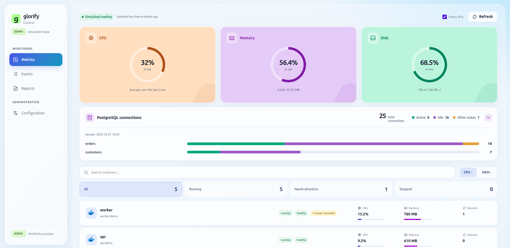
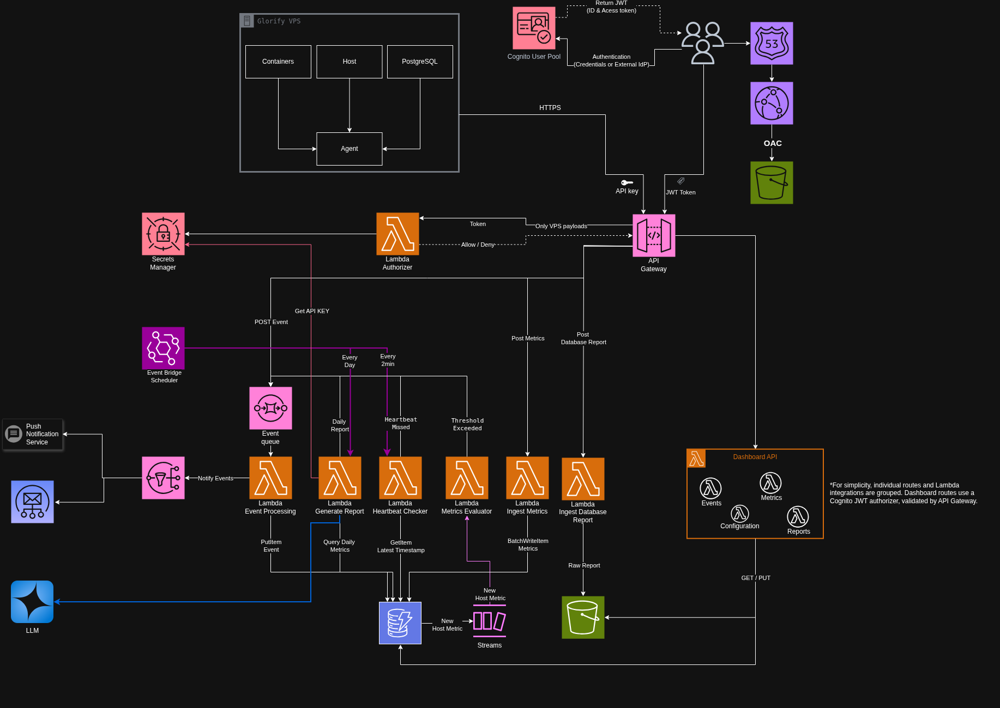

# Glorify Control

Glorify Control monitors a Linux VPS with a Python agent and an AWS serverless backend. It turns host metrics, Docker events and PostgreSQL statistics into alerts and daily operational reports. We built it to practice failure-mode design: recovering queued work, handling duplicate events and preserving evidence across retries.

### Live Demo

  <a href="https://m4ti11.github.io/glorify_control_demo/">
    <strong>Explore the Live Demo →</strong>
  </a>

## Architecture

The architecture separates data collection, asynchronous event processing and daily operational reporting. The agent collects host, Docker and PostgreSQL data; AWS services handle ingestion, storage, alert evaluation and report generation.

The dashboard brings these flows together through metrics, an event timeline, raw PostgreSQL captures and operational analysis. The public demo runs on static files; the diagram describes the complete backend implementation. See [architecture](docs/architecture.md) for the flows, API routes and storage model.

## Repository map

| Folder | What it shows | Start reading |
| --- | --- | --- |
| `agent/` | Linux host, Docker and PostgreSQL collection; bounded SQLite spool | `src/glorify_control_agent/scheduler.py` |
| `backend/` | Lambda handlers, domain logic, repositories and offline tests | `lambda/ingest_metrics/service.py` |
| `frontend/` | Dashboard views with bundled example data | `api.js`, then `app.js` |
| `infrastructure/` | Terraform bootstrap and application resources | `environments/prod/api_gateway.tf` |
| `docs/` | Architecture, design decisions and operational notes | [decisions](docs/decisions.md) |
| `samples/` | Generated payloads, notification examples and report PDF | `payloads/heartbeat.json` |
| `scripts/` | Packaging, IaC validation and publication checks | `scan_showcase.py` |

## What we wanted to demonstrate

We used API Gateway for ingress and JWT authorization, Lambda for bounded processing, DynamoDB for conditional writes and time-keyed history, SQS for retries and DLQs, S3 for report objects, EventBridge Scheduler for timed jobs, and SNS/SES for notifications. Cognito supplies dashboard identities; Secrets Manager keeps secret values outside Terraform. CloudWatch connects pipeline errors and missing heartbeats to operational alarms.

We focused on deterministic event UUIDs, idempotency checks, pending alerts persisted before enqueueing, hysteresis between alert and recovery thresholds, delivery checkpoints and expiring leases. Terraform makes resource and permission boundaries reviewable.

Our [decisions and trade-offs](docs/decisions.md) explain the single-VPS snapshot, direct SQS integration and immutable reports. [Deployment notes](docs/deployment.md) describe how the backend can be installed separately.

## Reports

Reports combines two views for the selected server and date: raw PostgreSQL captures for inspecting SQL and database statistics, and operational analysis that brings together host metrics, events and PostgreSQL evidence. The analysis presents a summary, findings, recommendations and source coverage. Reports can be previewed in a PDF modal or downloaded.

## Design scope

We designed the system around one trusted VPS and one operator group. Our [security notes](docs/security.md) explain the trust boundaries, and the [runbook](docs/runbook.md) covers operational recovery. The demo uses invented data and a sample analysis; live monitoring and AI generation belong to the separate backend deployment.

This is an AWS learning project and a code sample for our portfolio.
